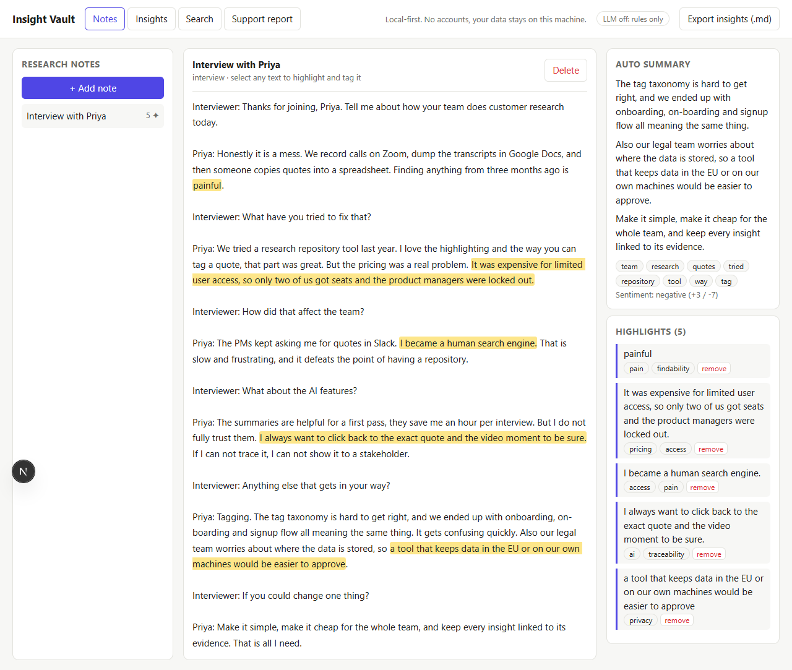
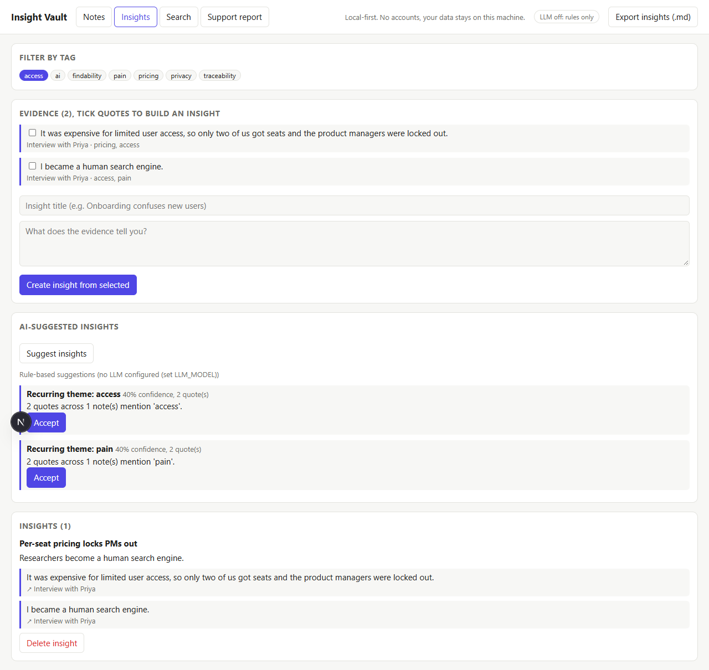
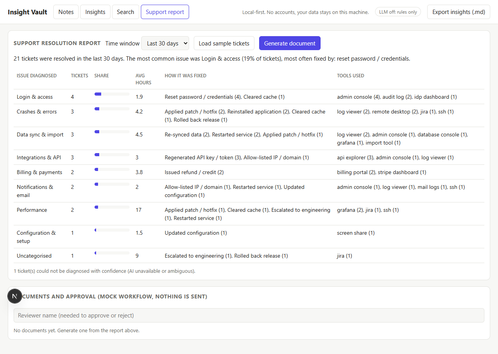

# Insight Vault

**A private, local-first workspace that turns interview transcripts and support tickets into evidence-backed insights.**

- Highlight and tag quotes in transcripts, then group them into insights that stay linked to their source.
- Ask an LLM to suggest insights. Every suggestion is validated against your real quotes.
- See which issues were diagnosed in the last 7, 14, 30, 60 or 90 days and how support agents fixed them.
- Turn that report into a document and send it through a (mock) approval workflow.

Your data stays on your machine in a single JSON file. The LLM is optional: without one, everything still works using deterministic rules.

| Notes and highlights | AI-suggested insights | Support resolution report |
|---|---|---|
|  |  |  |

A complete example of the generated document, sent for approval, is in [`docs/sample-support-report.md`](docs/sample-support-report.md).

## Architecture

```text
Browser ──► Next.js + React (frontend/, port 3000)
               │  /api/* proxied
               ▼
            Flask API served by Waitress (backend/, port 5001)
               ├── JSON file store      data/db.json (atomic writes, lock-protected)
               ├── Deterministic rules  keyword classifier, fix extractor, tag grouping
               └── LLM via LiteLLM      optional; any provider LiteLLM supports, including OpenRouter
```

| Folder | What it contains |
|---|---|
| `backend/` | Python API, analysis, LLM client, caching and concurrency helpers |
| `frontend/` | Next.js app (React components in `src/components`) |
| `tests/` | Python tests (pytest) |
| `frontend/tests/` | React tests (Vitest and Testing Library) |
| `e2e/` | Browser tests that drive the real app (Playwright) |
| `samples/` | Fictional interview transcript and 30 fictional support tickets |
| `docs/` | Screenshots and the sample approval document |

## Quick start

You need **Python 3.10+** and **Node.js 18+**.

```bash
git clone https://github.com/bhuwanthada/insight-vault.git
cd insight-vault
npm run setup      # creates .venv, installs Python and Node dependencies (once)
npm start          # starts the API and the UI, then opens http://localhost:3000
```

On Windows, after `npm run setup`, you can double-click `start.bat` instead.

The first start builds the UI, which takes about a minute.

### Try it with the sample data

1. **Transcript:** click **+ Add note**, load `samples/interview-priya.txt`, then select text to highlight and tag it.
2. **Support report:** open the **Support report** tab, click **Load sample tickets**, then change the time window.
3. **Document:** click **Generate document**, **Send for approval (mock)**, enter a reviewer name and click **Approve**.

## Using an LLM (optional)

The app talks to LLMs through [LiteLLM](https://docs.litellm.ai), so you choose the model with one setting. To use OpenRouter:

```bash
# Windows PowerShell
$env:LLM_MODEL = "openrouter/<vendor>/<model>"
$env:OPENROUTER_API_KEY = "<your key>"
npm start
```

Any other LiteLLM model id works the same way, with that provider's own API key variable.

| Variable | Default | Purpose |
|---|---|---|
| `LLM_MODEL` | empty (LLM off) | LiteLLM model id |
| `LLM_API_KEY` | empty | Optional key; otherwise LiteLLM reads the provider's variable |
| `LLM_TIMEOUT` | `30` | Seconds before a call is abandoned |
| `LLM_MAX_RETRIES` | `2` | Retries per call, with exponential backoff and jitter |
| `LLM_MAX_CONCURRENCY` | `4` | Maximum simultaneous LLM calls |
| `LLM_VOTES` | `3` | Samples per ambiguous ticket (see below) |
| `LLM_VOTE_TEMPERATURE` | `0.7` | Sampling temperature for those votes |
| `CACHE_TTL` / `CACHE_SIZE` | `3600` / `512` | Cache lifetime in seconds and maximum entries |
| `PORT` / `DATA_FILE` | `5001` / `data/db.json` | API port and storage path |

The header shows whether an LLM is active. Your quotes and tickets are sent to the model provider you choose, so pick one that fits your privacy needs.

## How it stays reliable

**Deterministic first, probabilistic when needed.**
Support tickets are diagnosed by keyword rules. A clear match is decided instantly, for free, and the same way every time. Only ambiguous tickets go to the LLM. They are sampled several times and the majority answer wins. The share of votes that agree is the confidence score. The LLM's answer must be one of the fixed categories, or it is ignored.

**Insights are validated.**
LLM-suggested insights must cite quote ids that exist. Invented ids are dropped, and confidence is the share of cited ids that were real. If nothing valid remains, the app falls back to a rule that groups quotes sharing a tag.

**Caching.**
Trustworthy LLM results are cached (LRU with expiry), keyed by a hash of the input, the model and the prompt version. Fallback results are never cached, so a recovered LLM is used again straight away.

**Race conditions.**
- *Duplicate work:* identical requests that arrive together share one LLM call (single-flight), so a burst of reports does not stampede the provider.
- *Lost updates:* reads and writes of the data file share one lock, and files are replaced atomically. A test runs four writers and three readers at once and checks that no update is lost.
- *Approvals:* a document's status changes by compare-and-set under the lock. If eight people approve and reject at the same moment, exactly one wins and the rest receive `409 Conflict`.

**Failure handling.**
Each LLM call has a timeout, a concurrency limit, retries with backoff, and a circuit breaker that stops calling a failing provider for 30 seconds. When the LLM is unavailable the app degrades to rules and says so in the UI.

## The support report

Pick a time window and the report shows, for tickets resolved in that period:

- the **issue categories diagnosed**, with ticket counts, share and average time to resolve
- **how each was fixed**: the actions agents took (for example "Reset password / credentials") and the tools they used
- the busiest agents and how many diagnoses were low-confidence

Fixes are extracted from the resolution notes by rules, so they are consistent and explainable. Generated documents move through `draft`, `pending approval`, `approved` or `rejected`. The approval is a **mock**: it records the request and decision locally and sends nothing.

To ingest your own tickets, `POST` JSON to `/api/tickets` with `subject`, `resolution`, `createdAt`, `resolvedAt` (ISO-8601) and optionally `agent`, `tools_used` and `description`.

## API summary

| Method and path | Purpose |
|---|---|
| `GET /api/health`, `GET /api/llm/status` | Liveness and LLM configuration |
| `GET /api/state` | Notes, highlights and insights |
| `POST /api/notes`, `GET`/`DELETE /api/notes/<id>` | Manage notes |
| `GET /api/notes/<id>/analysis` | Keywords, summary, sentiment |
| `POST /api/highlights`, `PATCH`/`DELETE /api/highlights/<id>` | Manage highlights |
| `POST /api/insights`, `POST /api/insights/suggest`, `DELETE /api/insights/<id>` | Insights and AI suggestions |
| `GET /api/search?q=` | Search notes, quotes and tags |
| `GET /api/export` | Download insights as Markdown |
| `GET`/`POST /api/tickets`, `POST /api/tickets/sample` | Support tickets |
| `GET /api/report?days=7\|14\|30\|60\|90` | Resolution report |
| `GET`/`POST /api/reports`, `POST /api/reports/<id>/submit`, `POST /api/reports/<id>/decision` | Documents and mock approval |

## Tests

```bash
npm test            # backend and frontend unit tests, both enforcing 100% coverage
npm run test:e2e    # real browser tests against the running stack (needs Chrome or Edge)
```

| Suite | Tests | Coverage |
|---|---|---|
| Backend (pytest) | 74 | 100% of statements and branches (enforced) |
| Frontend (Vitest) | 48 | 100% of statements, branches, functions and lines (enforced) |
| End-to-end (Playwright) | 20 | Full user journeys, with screenshots in `e2e/screenshots/` |

The unit tests never call a real LLM: it is replaced by a scripted fake. The end-to-end suite runs with no LLM configured, so it exercises the rules fallback.

## Limitations

- The built-in sentiment and summary use simple word counting, not a language model.
- There is no audio or video transcription. Paste text or load a transcript file.
- Storage is one JSON file on one machine, which suits a single team but not heavy multi-user use.
- The approval workflow is a mock and sends no email or chat message.
- There is no login, so run it on a trusted machine or network. The API listens on `localhost` only.

## License

[MIT](LICENSE) © 2026 Bhuwan Thada
