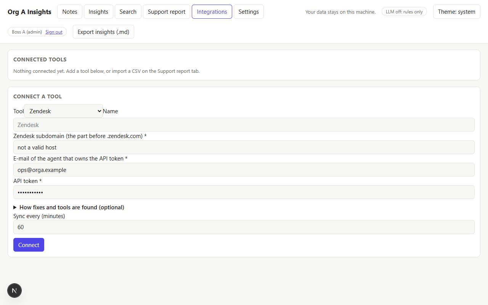
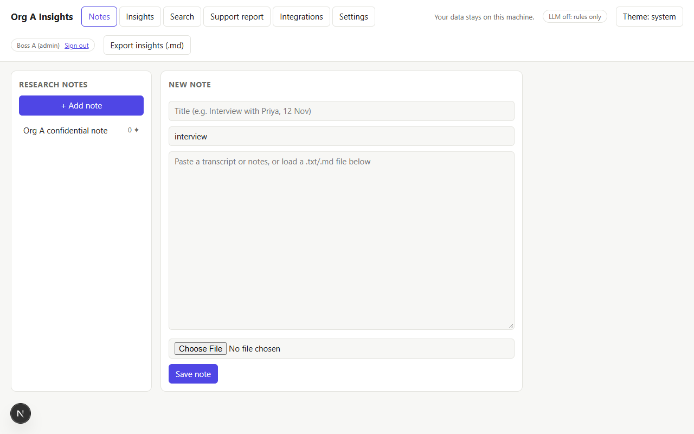
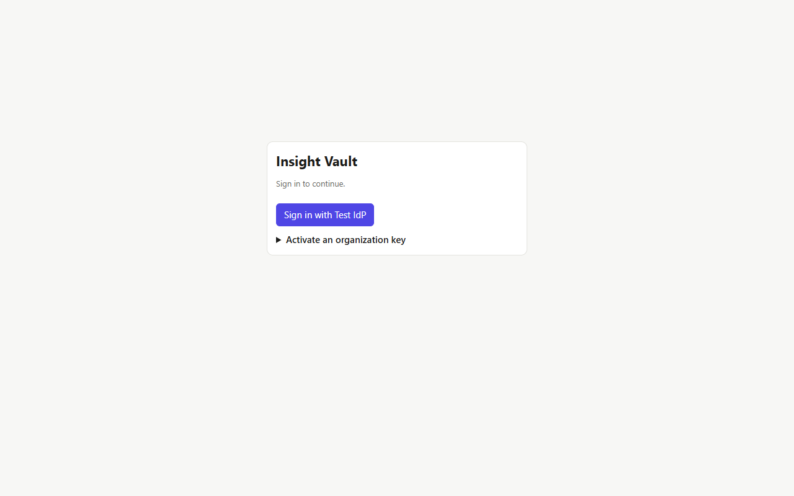
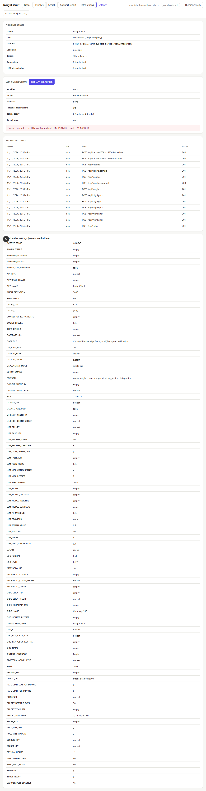

# Insight Vault

**Turn customer interviews and support tickets into evidence-backed insights. Sold to one company, or run as a SaaS for many.**

- Highlight and tag quotes in transcripts, then group them into insights that stay linked to the exact quote.
- Ask an LLM to suggest insights. Every suggestion is validated against your real quotes.
- Pull resolved tickets from **Zendesk, Freshdesk, Jira Service Management, ServiceNow and Salesforce Service Cloud**, or import a CSV from any other tool.
- See which issues were diagnosed in the last 7, 14, 30, 60 or 90 days, how agents fixed them and which tools they used. Turn the report into a document and send it through approval.
- Sign in with Google, LinkedIn, Microsoft or your own OpenID Connect provider, with roles and an audit log.
- One product, two ways to run it: a **single-company install** defined by a license key, or a **multi-tenant SaaS** where each organization is created by its own signed key.
- Runs on AWS, Google Cloud, Azure or your own machines. The LLM is optional.

| Notes and highlights | Support resolution report | Connect ticketing tools |
|---|---|---|
|  |  |  |

| Organization, plan and people (SaaS) | Activate an organization key | Admin settings |
|---|---|---|
|  |  |  |

A complete example of the generated report document, sent for approval, is in [`docs/sample-support-report.md`](docs/sample-support-report.md).

## Choose how to run it

| | Single company | SaaS (many organizations) |
|---|---|---|
| Setting | `DEPLOYMENT_MODE=single_org` (default) | `DEPLOYMENT_MODE=multi_tenant` |
| Who configures it | the company, through `.env` | you configure the platform; each organization configures itself |
| Defined by | an optional **license key** you sell | one **organization key** per customer |
| Storage | a JSON file (demo) or PostgreSQL | PostgreSQL |
| Sign-in | `.env` lists, or SSO | each organization's own member list, via SSO |
| Isolation | one organization | every record belongs to one organization; one can never see another |
| Integrations | need a database | need a database |

The key is the heart of both. A key carries the organization, plan, enabled features, quotas, domains, administrators and expiry, signed so it cannot be forged. See [Organization keys and licenses](docs/organization-keys.md) for how to mint and use them.

## Quick start (one person, one machine)

You need **Python 3.10+** and **Node.js 18+**.

```bash
git clone https://github.com/bhuwanthada/insight-vault.git
cd insight-vault
npm run setup      # creates .venv, installs dependencies, and creates your .env from .env.example (once)
npm start          # starts the API and the UI, then opens http://localhost:3000
```

On Windows, after `npm run setup`, you can double-click `start.bat`. The first start builds the UI (about a minute).

By default there is **no login, no LLM and no database**, which suits one person trying it out.

1. **Transcript:** click **+ Add note**, load `samples/interview-priya.txt`, then select text to highlight and tag it.
2. **Support report:** open **Support report**, click **Load sample tickets**, then change the time window.
3. **Document:** click **Generate document**, **Send for approval (mock)**, enter a reviewer name and click **Approve**.

## Configuration: the `.env` file

`npm run setup` creates `.env` from [`.env.example`](.env.example), which documents **every setting**. `.env` is git-ignored, so keys never get committed. Real environment variables override it, and a wrong value stops startup with a message naming every problem.

| Group | What you can customize |
|---|---|
| **Deployment and tenancy** | single company or SaaS, database, license key, signing public key, master key for stored secrets, operator keys, Redis |
| **LLM** | provider, model, key, base URL, fallbacks, a model per task, temperature, tokens, timeout, retries, votes, circuit breaker, daily token cap, personal-data masking, JSON mode, prompt files, language |
| **Rules and reports** | issue categories and fix patterns (YAML), report layout (Markdown template), confidence thresholds, the "last X days" choices |
| **Connectors** | first-sync depth, pages per run, extra allowed vendor domains, worker polling |
| **Sign-in** | mode, providers, who may sign in, roles, self-approval rule, session length |
| **Server and security** | host, port, threads, logs, upload limit, CORS, proxy trust, rate limits, audit retention |
| **Look and feel** | name, accent color, theme, which features are shown, date locale |

Administrators see the active settings (secrets hidden) in the **Settings** tab. In SaaS mode, each organization's administrators also edit their own branding, LLM choice, rules, report layout and LLM key there.

## Choosing an LLM provider

Set `LLM_PROVIDER` and `LLM_MODEL` in `.env`:

| `LLM_PROVIDER` | Use it for | Extra install |
|---|---|---|
| `groq` | Groq directly over HTTP. Fast and inexpensive, a good fit for classification | none |
| `openrouter` | OpenRouter directly over HTTP. Any model on their list | none |
| `openai_compatible` | Any OpenAI-style server: Ollama, vLLM, LM Studio, a company gateway. Needs `LLM_BASE_URL` | none |
| `litellm` | Any model LiteLLM supports (100+ providers) | `npm run setup:litellm` |
| `none` | LLM off, rules only (the default) | none |

```bash
# .env: Groq
LLM_PROVIDER=groq
LLM_MODEL=<a model id from your Groq console's model list>
LLM_API_KEY=<your key>          # or GROQ_API_KEY
LLM_JSON_MODE=true              # ask for strict JSON if your model supports it
```

More options: `LLM_FALLBACKS` (try another model when one fails, mixing providers), `LLM_MODEL_CLASSIFY` / `_INSIGHTS` / `_SUMMARY` (a cheap model to classify, a stronger one to write), `LLM_DAILY_TOKEN_CAP` (spending guard), `LLM_PII_MASKING=true` (mask e-mails, phone and card numbers before text leaves your machine), `PROMPT_DIR` (your own prompts). When a provider answers "slow down", the app waits as long as the provider asked.

### Test your LLM for real

```bash
npm run llm:check
```

Reads your `.env` and exercises the configured model: connection, **classification accuracy on 10 labeled tickets**, valid-JSON rate, whether suggested insights cite real quotes, summary quality, latency and token use. It never prints your key. Exit code `0` all good, `1` a check failed, `2` no LLM configured. `--samples 4` uses fewer calls.

## Single sign-on and roles

Set `AUTH_MODE=sso`. Sign-in uses OpenID Connect (authorization code with PKCE) and signed, HTTP-only session cookies.

**Access is denied by default.** In a single-company install an address must be in `ALLOWED_EMAILS` or on an `ALLOWED_DOMAINS` domain. In SaaS mode, each organization's member list decides.

| Role | Can do |
|---|---|
| `viewer` | Read everything |
| `editor` | Also add and change notes, highlights, insights, tickets, imports and documents |
| `approver` | Also approve or reject documents (never your own, unless `ALLOW_SELF_APPROVAL=true`) |
| `admin` | Also see Settings and the audit log, manage connectors, people and organization settings |

Register this **redirect URI** with every provider: `<PUBLIC_URL>/api/auth/callback/<provider>`.

| Provider | Where to register | `.env` keys |
|---|---|---|
| Google | Google Cloud console, OAuth client ID (Web application) | `GOOGLE_CLIENT_ID`, `GOOGLE_CLIENT_SECRET` |
| LinkedIn | LinkedIn developer portal; add **Sign In with LinkedIn using OpenID Connect** | `LINKEDIN_CLIENT_ID`, `LINKEDIN_CLIENT_SECRET` |
| Microsoft | Entra ID app registration; the tenant must be **your own**, not `common` | `MICROSOFT_CLIENT_ID`, `MICROSOFT_CLIENT_SECRET`, `MICROSOFT_TENANT` |
| Any OpenID Connect provider | Okta, Auth0, Keycloak, ... (redirect URI ends in `/oidc`) | `OIDC_NAME`, `OIDC_METADATA_URL`, `OIDC_CLIENT_ID`, `OIDC_CLIENT_SECRET` |

Scripts can use `Authorization: Bearer <key>` with an API key (`API_KEYS`, single company) or an organization key.

## Ticketing tools

Admins connect a tool in **Integrations**. The worker (`npm run worker`, or the `worker` container) syncs each connector on its schedule; **Sync now** runs one immediately.

| Tool | Connects with | How tickets are read |
|---|---|---|
| Zendesk | subdomain, agent e-mail, API token | incremental ticket export with cursors; solved/closed tickets |
| Freshdesk | domain, API key | tickets updated since the last sync; resolved/closed |
| Jira Service Management | site, e-mail, API token, optional project and JQL | JQL search with page tokens; Done tickets |
| ServiceNow | instance, user, password, optional table | Table API; resolved/closed; `close_notes` is the fix |
| Salesforce Service Cloud | instance host, connected-app credentials or a token | SOQL on closed cases; latest case comment is the fix |
| Any other tool | a CSV export | columns found by common names, or mapped; re-importing never duplicates |

**What "how it was fixed" means.** Tools have no single "resolution" field, and "tools the agent used" is rarely recorded. By default the fix is the agent's last reply, and tools come from tags such as `tool:grafana`. Each connector can point at a custom field instead (*How fixes and tools are found*). The report is only as good as the data in your tickets.

**Safety.** Credentials are stored encrypted (`SECRETS_KEY`). Connectors only contact each vendor's real domains over HTTPS and never follow redirects, so an organization cannot aim the server at internal addresses. Syncs resume page by page and respect the plan's ticket limit.

## Deploying

The product is cloud-neutral: an API and web image, PostgreSQL, optional Redis, and the worker.

```bash
npm run setup            # creates .env; set POSTGRES_PASSWORD and SECRETS_KEY in it
docker compose up --build   # PostgreSQL, Redis, API, worker and web on one machine
```

* [Deployment overview](docs/deploy/README.md), plus step-by-step guides for [AWS](docs/deploy/aws.md), [Google Cloud](docs/deploy/gcp.md) and [Azure](docs/deploy/azure.md).
* `deploy/kubernetes/insight-vault.yaml` runs on any Kubernetes cluster (EKS, GKE, AKS, your own).
* Run more than one API copy by setting `REDIS_URL`: the cache, rate limits and "one LLM call at a time" lock are then shared. If Redis blips, the app keeps working.
* Health checks: `/api/health` and `/api/ready`. Metrics: `/api/metrics`. Logs: `LOG_FORMAT=json`.

## How it stays reliable

**Deterministic first, probabilistic when needed.** Tickets are diagnosed by keyword rules; only ambiguous ones go to the LLM, which is asked several times and the majority wins. The LLM's answer must be one of your categories.

**Insights are validated.** LLM-suggested insights must cite quote ids that exist; invented ids are dropped.

**Caching and races.** Trusted LLM answers are cached per organization (memory, or Redis when shared). Identical concurrent requests share one LLM call. Reads and writes of an organization's data are serialized (an advisory lock on PostgreSQL), and approvals use compare-and-set, so eight people approving and rejecting at once produce exactly one winner and seven `409` answers.

**Failure handling.** Every LLM call has a timeout, a concurrency limit, retries with backoff, a token budget and a circuit breaker per model. All models failing degrades to rules and says so in the UI.

## Tests

```bash
npm test            # backend and frontend unit tests, both enforcing 100% coverage
npm run test:e2e    # real browser tests against the running stack (needs Chrome or Edge)
```

| Suite | Tests | What it proves |
|---|---|---|
| Backend (pytest) | 487 | 100% of statements and branches, enforced. Tenant isolation, plans, expiry, suspension, key forgery, connectors, Redis, concurrency |
| Frontend (Vitest) | 111 | 100% of statements, branches, functions and lines, enforced |
| End to end (Playwright) | 40 | Single user, real OpenID Connect sign-in against a local provider, and the full SaaS journey with real signed keys |

CI runs the backend tests on SQLite **and on a real PostgreSQL**, and the frontend tests and production build, on every push.

## Honest status

- **Connectors are verified against recorded-style fixtures, not live accounts.** They follow each vendor's documented API, but I had no Zendesk, Freshdesk, Jira, ServiceNow or Salesforce account to test against. Run a *Test* and a small first sync on a sandbox before relying on one.
- **Sign-in** is verified against a standards-compliant fake provider, not live Google, LinkedIn or Microsoft accounts.
- **Cloud guides** and the Kubernetes manifests are checked for syntax and for matching this product's settings, but have not been deployed to a live AWS, Google Cloud or Azure account.
- **The Docker images** have been written and the compose file validated, but have not been built on a machine with Docker running.
- The built-in sentiment and summaries use simple word counting, not a language model. There is no audio or video transcription.
- The approval workflow is a mock and sends no e-mail or chat message.
- Billing and payments are not included: plans and limits are enforced, but charging for them is up to you.
- Run it behind https in any shared deployment (`COOKIE_SECURE=true`).

## License

[MIT](LICENSE) © 2026 Bhuwan Thada
